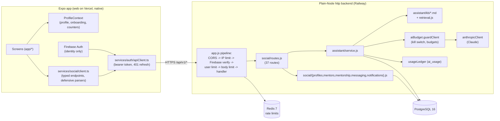
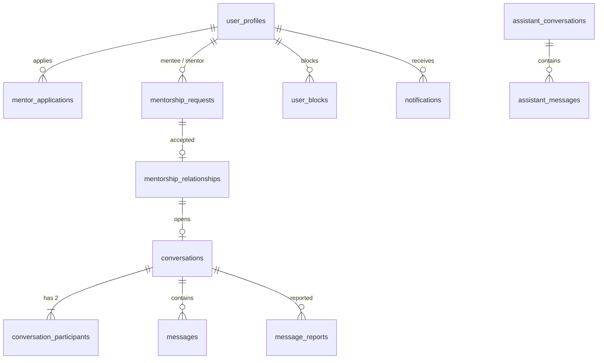
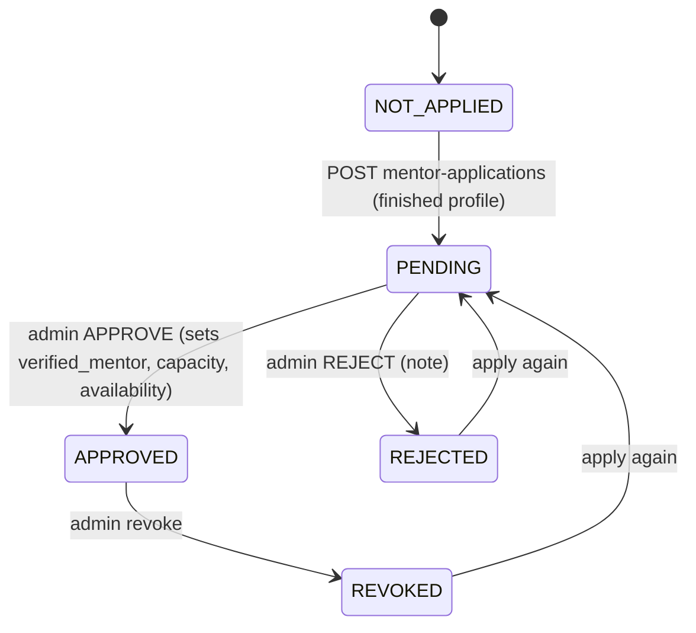
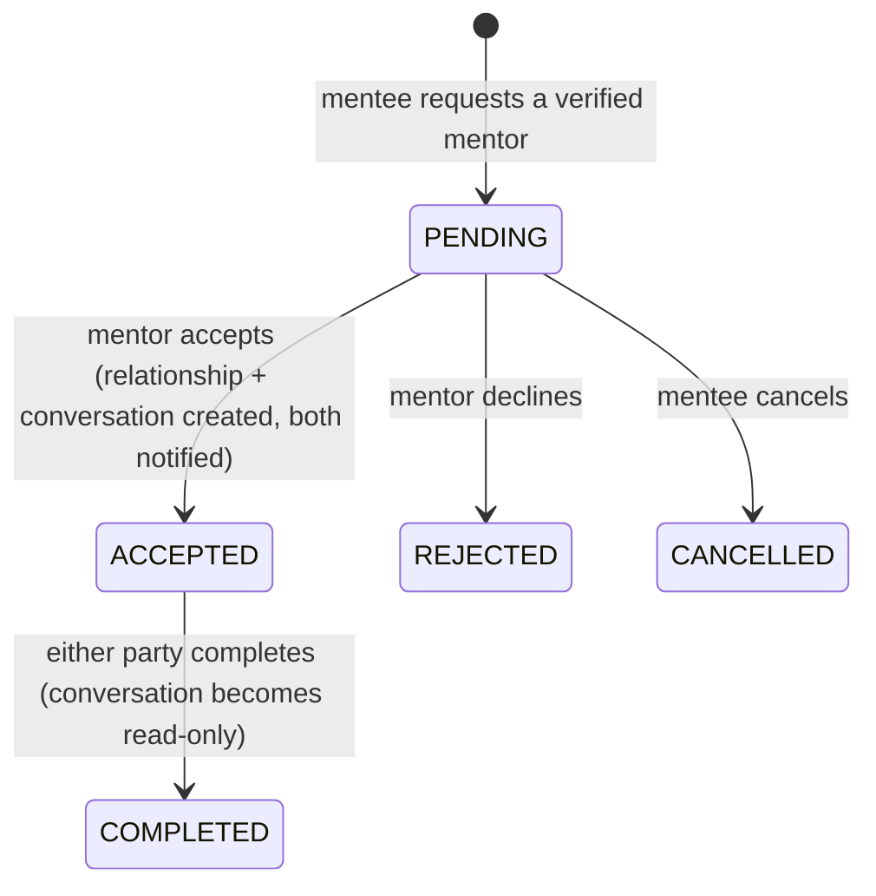
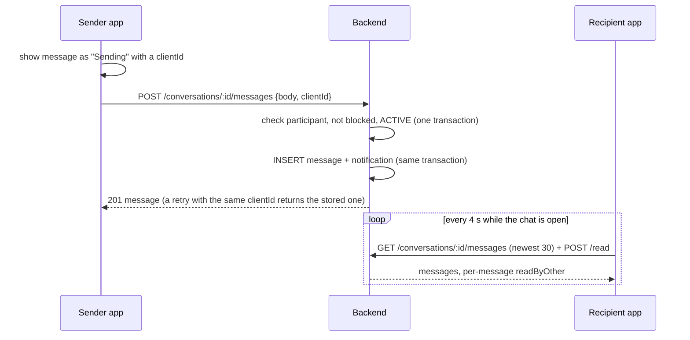
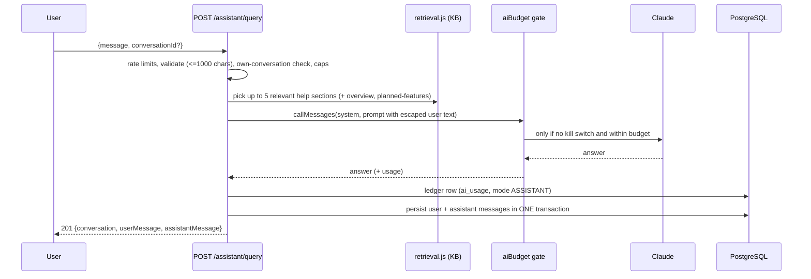

# shoRDs community platform: profiles, mentorship, messaging, notifications and the shoRDs Assistant

Status: implemented and tested **locally** against real PostgreSQL 16 and Redis 7 (see section 14). Nothing here has been deployed, migrated against a
production database, or exercised with a real Firebase sign-in or a real Anthropic call. Section 16 lists what must happen before it is used by real people.

Contents: 1 Functionality, 2 Routes, 3 Architecture, 4 API endpoints, 5 Database tables, 6 Authentication and permissions, 7 Mentor workflow,
8 Messaging, 9 Notifications, 10 shoRDs Assistant, 11 AI integration, 12 Environment variables, 13 Local setup, 14 Testing, 15 Known limitations,
16 Deployment requirements.

---

## 1. Functionality

| Area | What a person can do | Where it lives |
|---|---|---|
| Profiles | Choose one of five profile types (Student, Mentor, Researcher, Professor/Academic, Independent enthusiast), fill a staged onboarding, edit the profile, view others' public profiles. Email is private. | PostgreSQL `user_profiles` |
| Mentor application | Apply to become a **verified mentor**. Only an administrator can approve or reject. | `mentor_applications` |
| Mentor discovery | Search, filter (domain, expertise, skill, institution, level, availability), sort and page through **verified** mentors only; open a mentor page. | `GET /mentors` |
| Mentorship | Send a request to one mentor; the mentor accepts or declines; the mentee can cancel; either side can mark an active mentorship completed. | `mentorship_requests`, `mentorship_relationships` |
| Messaging | Text-only conversations between mentor and mentee (opened on acceptance) and optional direct messages (opt-in). Unread counts, read receipts, block, report. | `conversations`, `messages` |
| Notifications | In-app notifications for requests, decisions, new messages, completion and account events. | `notifications` |
| shoRDs Assistant | Ask how to use the app. Answers come from a versioned help knowledge base through the existing metered Claude gateway. Conversations are saved per user. | `assistant_*` tables, `backend/assistant/` |

Things that are deliberately **not** here: email or push notifications, real-time (WebSocket/SSE) delivery, file attachments, group chats, payments, video calls,
admin dashboards beyond one minimal review screen, mentor reviews/ratings, and any AI feature other than the existing Research Copilot and the new Assistant.

## 2. Routes (Expo Router)

| Route | Screen | Notes |
|---|---|---|
| `/onboarding` | Staged profile setup | Entered once after sign-in when the profile is unfinished; "Skip for now" always works |
| `/profile/edit` | Edit own profile | Allow-listed fields only |
| `/profile/[uid]` | Profile page | Own uid shows the private block; others get the public view |
| `/(tabs)/mentors` (`/mentors`) | Verified-mentor directory + hub links | Replaces the old "unavailable" stub |
| `/mentors/[uid]` | Mentor detail, request mentorship, message | 404 unless the person is a verified mentor |
| `/mentor/application` | Apply / see status | |
| `/mentor/review` | Administrator review of applications | Shows "Administrators only" to everyone else; the server enforces it regardless |
| `/mentorship/requests` | Received and sent requests | |
| `/mentorship` | Active and completed mentorships | |
| `/messages`, `/messages/[id]` | Conversation list and chat | Polling, see section 8 |
| `/notifications` | Notification list | |
| `/assistant`, `/assistant/history` | shoRDs Assistant chat and history | Labelled "App help, not the Research Copilot" |

A floating **Help** button opens `/assistant` from every signed-in screen except sign-in, onboarding, messages, the Copilot chat and the paywall. The Mentors tab in the
dock shows an unread badge (notifications + messages). The Profile tab links to the community profile, notifications and the Assistant. The Research Copilot
(`app/chat/[id].tsx`, `/api/v1/copilot/*`) is untouched.

## 3. Architecture



Key decisions:

* **Firebase authenticates; PostgreSQL decides everything else.** The Firebase `uid` is the external identity. No passwords or Firebase tokens are stored. The server
  takes the caller from the verified token and never from a request body or URL.
* **Five separate concepts, never merged:** (1) profile type `persona` (self-chosen, cosmetic); (2) mentor application status
  (`NOT_APPLIED | PENDING | APPROVED | REJECTED | REVOKED`); (3) `verified_mentor` (set only by an admin decision); (4) platform admin (uid listed in `ADMIN_UIDS`,
  read from the environment, never stored in the database or accepted from a client); (5) project role (VIEWER..OWNER) which this work does not touch.
* **State machines live on the server.** The client's buttons only reflect what the server permits; a stale or forged request is refused with 409.
* **Same transaction for the event and its notification**, so a notification can never exist for something that did not happen (and vice versa).
* **Zero new dependencies.** The routes are added to the existing route table (`app.js` ends with `social.match(method, seg)`); the Postgres and Redis clients are the existing ones.
* **Pure frontend services with an injected `api`**, so request shapes and parsing are unit-tested under Node.

Request pipeline for a protected call: CORS check -> per-IP rate limit -> Firebase token verification -> per-user rate limit -> JSON body limit and parse -> handler
(`guard` converts `SocialError` to a safe JSON error) -> parameterised SQL.

## 4. API endpoints (all under `/api/v1`, all require a verified Firebase ID token)

Rate-limit names are Redis fixed-window policies (section 12). "Admin" means the uid is in `ADMIN_UIDS`; non-admins get 403.

| Method and path | Purpose | Authorisation | Limit |
|---|---|---|---|
| `GET profiles/me` | Own profile, `onboardingRequired`, `isAdmin` | self | READ_USER |
| `PUT profiles/me` | Create/update own profile (allow-list; `completeOnboarding`) | self | PROFILE_WRITE_USER |
| `GET profiles/:uid` | Public profile (own uid returns the private block) | any signed-in; unfinished profiles are 404 | READ_USER |
| `GET mentors` | Verified-mentor directory (`q, domain, expertise, skill, institution, level, availability, sort=recent|name|availability, limit<=50, offset`) | any signed-in; never lists the caller | READ_USER |
| `GET mentors/:uid` | One verified mentor | 404 unless verified and onboarded | READ_USER |
| `GET mentor-applications/me` | My latest application | self | READ_USER |
| `POST mentor-applications` | Apply (creates PENDING) | self; needs a finished profile; one PENDING at a time | MENTOR_APPLY_USER |
| `GET admin/mentor-applications?status=` | Review queue | admin | READ_USER |
| `PUT admin/mentor-applications/:id` | `{decision: APPROVE|REJECT, note?}` | admin; **403 `SELF_REVIEW_FORBIDDEN` if it is the admin's own application**; REJECT needs a note of at least 5 characters (`REASON_REQUIRED`) | ADMIN_USER |
| `POST admin/mentors/:uid/revoke` | Remove verification | admin | ADMIN_USER |
| `GET admin/reports` | Message reports | admin | READ_USER |
| `POST mentorship/requests` | Request mentorship | finished profile; target must be a verified mentor with open capacity; not yourself; no live duplicate | MENTOR_REQUEST_USER |
| `GET mentorship/requests?box=incoming|outgoing&status=` | My requests | parties only | READ_USER |
| `GET mentorship/requests/:id` | One request | parties only (404 otherwise) | READ_USER |
| `PUT mentorship/requests/:id` | `{action: ACCEPT|REJECT|CANCEL, note?}` | ACCEPT/REJECT: the mentor; CANCEL: the mentee; PENDING only | MENTORSHIP_ACTION_USER |
| `GET mentorship/relationships?status=` | My mentorships | parties only | READ_USER |
| `PUT mentorship/relationships/:id` | `{action: COMPLETE}` | either party; ACTIVE only | MENTORSHIP_ACTION_USER |
| `GET conversations` | My conversations with unread counts | participants | READ_USER |
| `POST conversations` | Start/reuse a direct conversation `{recipientUid}` | finished profile; recipient finished and accepting DMs (unless one already exists); not blocked | CONVERSATION_CREATE_USER |
| `GET conversations/:id` | One conversation | participants (404 otherwise) | READ_USER |
| `GET conversations/:id/messages?before=|after=&limit=` | History (newest page, oldest first) or messages after an id | participants | READ_USER |
| `POST conversations/:id/messages` | `{body (1-2000), clientId?}` | participant, conversation ACTIVE, not blocked | MESSAGE_SEND_USER |
| `POST conversations/:id/read` | Mark read up to now | participant | READ_USER |
| `POST conversations/:id/report` | `{reason, messageId?}` | participant | REPORT_USER |
| `PUT|DELETE users/:uid/block` | Block / unblock | self | MENTORSHIP_ACTION_USER |
| `GET notifications?unread=true&before=&limit=` | My notifications | owner | READ_USER |
| `GET notifications/unread-count`, `GET me/counters` | Badge counts | owner | READ_USER |
| `POST notifications/:id/read`, `POST notifications/read-all` | Mark read | owner only (SQL `WHERE uid = caller`) | WRITE_USER |
| `POST assistant/query` | `{message (<=1000), conversationId?}` -> 201 | owner of the conversation | ASSISTANT_USER, ASSISTANT_USER_DAILY |
| `GET assistant/suggestions` | Suggested questions | any signed-in | READ_USER |
| `GET assistant/conversations[/:id]` | My Assistant history | owner only | READ_USER |
| `DELETE assistant/conversations[/:id]` | Delete one / clear all of mine | owner only | WRITE_USER |

Errors are JSON `{error: CODE, message, requestId}`. Codes you will meet: `FIELD_NOT_ALLOWED` (a privileged key such as `verifiedMentor`, `isAdmin`, `role`),
`UNKNOWN_FIELD`, `PROFILE_REQUIRED`, `APPLICATION_PENDING`, `ALREADY_MENTOR`, `MENTOR_NOT_VERIFIED`, `MENTOR_UNAVAILABLE`, `CAPACITY_REACHED`, `DUPLICATE_REQUEST`, `STATE_CONFLICT` (a transition the current state does not allow),
`DIRECT_MESSAGES_OFF`, `BLOCKED`, `CONVERSATION_CLOSED`, `ASSISTANT_UNAVAILABLE` (503: no API key, or the AI is paused/over budget), `ASSISTANT_FAILED` (502: the provider failed or returned nothing), and the shared rate limiter's 429 with `Retry-After`. Unauthorised access to someone else's object is **404, not 403**, so ids cannot be probed.
CORS now allows `DELETE` (previously GET, POST, PUT, OPTIONS).

## 5. Database tables

Forward-only migrations v4-v6 in `backend/data/socialMigrations.js`, appended to the existing v1-v3. There is a hand-run, tested inverse (`SOCIAL_DOWN_SQL`) but the
migration runner never runs it. Migrations are **never** run by the tests against anything but the scratch database.



| Table | Purpose and the constraints that matter |
|---|---|
| `user_profiles` | PK `uid` (Firebase). Length CHECKs on every text field; enum CHECKs; `CHECK (NOT verified_mentor OR onboarding_completed_at IS NOT NULL)`; partial indexes serve the directory. `email` stored but never returned to others. |
| `mentor_applications` | Partial unique indexes: one PENDING and one APPROVED per uid. Status PENDING/APPROVED/REJECTED/REVOKED. Reviewer uid, note and time recorded. |
| `mentorship_requests` | `CHECK (mentee <> mentor)`; **unique (mentee, mentor) WHERE status IN (PENDING, ACCEPTED)** = no duplicate active request; length CHECKs. |
| `mentorship_relationships` | Unique (mentor, mentee) WHERE ACTIVE; `CHECK` that `ended_at` is set exactly when COMPLETED; records who ended it. |
| `conversations` / `conversation_participants` | `kind` MENTORSHIP (needs `relationship_id`) or DIRECT (needs a unique `direct_key`, so two people share one DM thread). Per-participant `last_read_message_id` drives unread counts and read receipts. |
| `messages` | `body` 1-2000; unique (conversation, sender, `client_id`) so a retried send is idempotent. |
| `user_blocks`, `message_reports` | Block pairs and reports (readable only through the admin endpoint). |
| `notifications` | Owner uid, type, title, body (<=400), JSON `data` (ids only), `read_at`. Partial index on unread. |
| `assistant_conversations` / `assistant_messages` | Owner uid on **both** tables; every query filters by uid. Stores the knowledge-base version, model and cited topic ids per answer. |

Total after migration: 19 tables (7 existing + 12 new). After `SOCIAL_DOWN_SQL`: back to 7.

## 6. Authentication and permissions

* Every community route runs after Firebase token verification; unauthenticated calls get 401 before any handler runs.
* **Identity** = verified token's `uid`. Request bodies are allow-lists: privileged keys are rejected (`FIELD_NOT_ALLOWED`), unknown keys are rejected (`UNKNOWN_FIELD`).
* **Admin** = uid in the `ADMIN_UIDS` environment variable. It cannot be granted through any endpoint. Separation of duties is enforced: an administrator can never approve, reject or revoke their own application or verification (403 `SELF_REVIEW_FORBIDDEN`); another administrator has to do it.
* **Ownership is enforced in SQL** (`WHERE uid = $caller`), not just in handlers; non-participants and non-owners get 404.
* **Directory:** `verified_mentor AND onboarding_completed_at IS NOT NULL`, and the caller is excluded. An unapproved applicant is never listed, and `GET mentors/:uid` is 404 for them.
* **Messaging permission model:** mentor and mentee can always message while the mentorship is ACTIVE (conversation created on acceptance); strangers can start a DM only if the recipient turned on "Accept direct messages" (off by default); blocks stop all sending in both directions; a completed mentorship makes its conversation read-only.
* **Privacy:** email is returned only on the caller's own profile; the Assistant never reads messages or other people's profiles (it only sees the question, the last turns of the caller's own Assistant chat and the help knowledge base).
* **SQL:** every value is a bound parameter; `LIKE` wildcards in searches are escaped; sort is chosen from a fixed map.
* **Abuse limits:** Redis rate limits per user and per IP, 503 (fail-closed) if Redis is down, JSON body size limit from `MAX_REQUEST_BODY_BYTES`.

## 7. Mentor workflow





Approval, relationship creation and the notifications each happen in **one transaction** with row locks (`FOR UPDATE`), so double-clicks and races cannot create two relationships
or exceed capacity. `MENTOR_APPLICATION_RECEIVED` notifications go to the uids in `ADMIN_UIDS`; if that variable is empty nobody is notified (the queue is still readable by an admin).
Revoking verification does not end live mentorships; their participants close them.

Admin workflow without the UI: `GET /api/v1/admin/mentor-applications?status=PENDING`, then `PUT /api/v1/admin/mentor-applications/<id>` with `{"decision":"APPROVE"}` using an
admin's ID token. The minimal screen at `/mentor/review` does the same.

## 8. Messaging



* **This is polling, not real-time.** The chat refreshes every 4 seconds while open, the conversation list every 8 seconds, and badges every 30 seconds. Delivery can lag by that much.
* Text only, 1-2000 characters. No attachments. Failed sends show "Not sent" with Retry (same `clientId`, so never stored twice) or Discard.
* Read status: each side's `last_read_message_id`; the sender sees "Sent" or "Seen" on their latest message. Unread counts are per conversation plus a total.
* Older history loads page by page (`before` cursor). Block and report are in the chat footer; reports are visible only to administrators.
* New-message notifications are collapsed per conversation so a burst does not create a notification per message.

## 9. Notifications

In-app only, stored in PostgreSQL, created inside the transaction of the event. Types: `MENTOR_APPLICATION_RECEIVED` (to admins), `MENTOR_APPLICATION_APPROVED`, `MENTOR_APPLICATION_REJECTED`,
`MENTOR_STATUS_REVOKED`, `MENTORSHIP_REQUEST_RECEIVED`, `MENTORSHIP_REQUEST_ACCEPTED`, `MENTORSHIP_REQUEST_REJECTED`, `MENTORSHIP_REQUEST_CANCELLED`, `MENTORSHIP_STARTED`,
`MENTORSHIP_COMPLETED`, `NEW_MESSAGE`. The screen lists, filters unread, marks one or all read and navigates using `notificationTarget`, which only produces in-app paths and
validates ids. **There are no emails and no push notifications**; a person sees a notification only when they open the app (the badge refreshes every 30 seconds while it is open).

## 10. shoRDs Assistant



* **It answers questions about using shoRDs**, not about papers. The Research Copilot remains the paper-discussion feature and the UI labels the two differently.
* **Knowledge base:** `backend/assistant/kb/*.md` (15 documents, `VERSION` = 2026.11.14) with front matter (`id`, `title`, `status`, `tags`). Documents describe the implementation as it is;
  features that are not built live in `planned-features.md` with `status: planned`, and the prompt tells the model to call them planned. Every answer stores the KB version and the cited topic titles.
* **Persistence:** conversations and messages are owned per user (uid on both tables). Limits: 50 conversations per user, 100 messages per conversation, last 6 turns used as context.
* **Failure behaviour:** no API key -> 503 `ASSISTANT_UNAVAILABLE` (nothing is invented, nothing is stored); policy denial (kill switch, budget) -> 503 `ASSISTANT_UNAVAILABLE` ("paused or at its usage limit") and a ledger row with `aiCalled=false`; provider failure or an empty answer -> 502 `ASSISTANT_FAILED`
  (ledger row with `aiCalled=true`, since it may have been billed); in every failure nothing is stored, so Retry cannot duplicate a turn.
* **Safety:** user text and history are placed in tagged blocks with `<`, full-width `＜` and `﹤` escaped, so a user cannot close the block and inject instructions; the model is told the blocks are data. The rendered answer
  goes through a small Markdown parser that never produces HTML; only `https` links are tappable.
* There are **no canned answers** and no keyword fallback that pretends to be AI.

## 11. AI integration

* The Assistant calls Claude through the same `anthropicClient.callMessages` the Copilot uses, wrapped by `budget.guardClient(client, {tenantId: personalTenant(uid), projectId: NO_PROJECT_ID, uid})`.
  The kill switch (`PUT /api/v1/admin/ai/kill-switch`) and the budgets therefore apply; a denied call never reaches the provider.
* **Every billable call is recorded** in the `ai_usage` ledger (`mode: ASSISTANT`). Token counts are stored only when the provider reported them (`tokens.source === "REAL_PROVIDER"`); otherwise they are not guessed.
* Model parameters: max 1200 output tokens, low effort, 45 s timeout. Per-user limits: 10/minute and 100/day (configurable).
* Two existing guard tests that pin "only these modules may reach the provider" were **deliberately extended** to list `assistant/service.js`, and a new guard test proves the Assistant reaches the provider only through the gate and always records the call.
* Tests never call Anthropic: a stub client is injected, and the no-key tests assert the stub was never invoked.

## 12. Environment variables (names only; never put values in the repository)

Backend: `DATABASE_URL`, `REDIS_URL`, `FIREBASE_PROJECT_ID`, `AUTH_REQUIRE_VERIFIED_EMAIL`, `ADMIN_UIDS`, `CORS_ORIGINS`, `MAX_REQUEST_BODY_BYTES`, `ANTHROPIC_API_KEY`, `ANTHROPIC_MODEL`,
`REQUIRE_AI_PROVIDER`, `PORT`, `NODE_ENV`, `TRUST_PROXY`, `TRUST_PROXY_HOPS`.
New rate-limit overrides (each `"<limit>/<windowSeconds>"`, defaults in parentheses): `RATE_LIMIT_PROFILE_WRITE_USER` (20/60), `RATE_LIMIT_MENTOR_APPLY_USER` (5/3600), `RATE_LIMIT_MENTOR_REQUEST_USER` (10/3600),
`RATE_LIMIT_MENTORSHIP_ACTION_USER` (30/60), `RATE_LIMIT_CONVERSATION_CREATE_USER` (20/3600), `RATE_LIMIT_MESSAGE_SEND_USER` (30/60), `RATE_LIMIT_REPORT_USER` (10/3600), `RATE_LIMIT_ADMIN_USER` (60/60),
`RATE_LIMIT_ASSISTANT_USER` (10/60), `RATE_LIMIT_ASSISTANT_USER_DAILY` (100/86400). Existing: `RATE_LIMIT_READ_USER`, `RATE_LIMIT_WRITE_USER`, `RATE_LIMIT_GLOBAL_IP`, `RATE_LIMIT_FAIL_MODE`.
Frontend (public by design; contain no secrets): `EXPO_PUBLIC_API_URL`, `EXPO_PUBLIC_FIREBASE_API_KEY`, `EXPO_PUBLIC_FIREBASE_AUTH_DOMAIN`, `EXPO_PUBLIC_FIREBASE_PROJECT_ID`, `EXPO_PUBLIC_FIREBASE_APP_ID`,
`EXPO_PUBLIC_FIREBASE_STORAGE_BUCKET`, `EXPO_PUBLIC_FIREBASE_MESSAGING_SENDER_ID`. The built web bundle was searched for `ANTHROPIC` and `sk-ant`: no match.

## 13. Local setup

```bash
# 1. Dependencies and databases (use throwaway local instances, never production)
npm ci
docker compose up -d postgres redis            # or any local PostgreSQL 16 + Redis 7

# 2. Backend environment (names only; fill in local values in your own shell or an untracked .env)
export DATABASE_URL=postgres://<user>:<password>@127.0.0.1:5432/<dev_db>
export REDIS_URL=redis://127.0.0.1:6379
export FIREBASE_PROJECT_ID=<your firebase project id>
export ADMIN_UIDS=<your firebase uid>           # to try the review screen
export ANTHROPIC_API_KEY=<optional; without it the Assistant answers 503, honestly>
node backend/start_local_server.js              # applies migrations v1-v6 to DATABASE_URL on start

# 3. App
export EXPO_PUBLIC_API_URL=http://127.0.0.1:<port>   # plus the EXPO_PUBLIC_FIREBASE_* names
npx expo start --web
```

Point `DATABASE_URL` only at a database you can lose; startup applies the migrations to whatever it names. See section 16 before touching a shared environment.

## 14. Testing

| Command | What it runs |
|---|---|
| `npm run test:node` | Unit suite (no database): includes `social.test.js` (validation, state machines, route table, KB, retrieval, prompt escaping) and `frontendCommunity.test.js` (markdown, parsers, format helpers, request-body builders, client with a fake API, `apiClient.delete`, route guard incl. no-loop proof) |
| `npm run test:integration` | Real PostgreSQL + Redis, real HTTP: includes `socialMigrations`, `community`, `assistant`, and the updated `migrationUpgrade` suite |
| `npx tsc --noEmit` | Type check of the whole app |
| `npx expo export -p web` | Production web bundle build |

The eight required security properties each have a named test (tagged SEC-1..SEC-8 in `community.integration.test.js` and `assistant.integration.test.js`): a user cannot read another's messages;
cannot modify another's profile; a student cannot self-approve; an unapproved mentor is absent from the directory; a non-participant cannot read a conversation; a user cannot mark another's notifications read;
a user cannot read another's Assistant history; a client cannot grant itself admin. The React screens are **not** rendered by any test (no React test renderer exists in this project) and have not been driven through a real sign-in.

## 15. Known limitations

* Messaging is polling (4 s) and notifications are in-app only: there is no live push, no email, no mobile push.
* No attachments, group chats, message editing/deletion, typing indicators or mentor reviews.
* Admin tooling is one minimal screen plus API; there is no UI for reports (`GET admin/reports` only), revocation, or reading the audit trail.
* `MENTOR_APPLICATION_RECEIVED` reaches administrators only if `ADMIN_UIDS` is set.
* Assistant answers are only as current as the knowledge base (`VERSION` 2026.11.14); it must be updated when features change. Model output can still be wrong; the UI says it is app help.
* The Assistant is single-turn retrieval over help text; it does not browse, remember across conversations or see the user's data.
* Web and native screens were type-checked and bundled but not exercised end-to-end with real Firebase accounts; no visual or accessibility audit on devices was done.
* Search uses a stored lowercase search text with `LIKE`, fine for thousands of mentors, not tuned for millions.
* Node 22's native TypeScript loader needs explicit `.ts` extensions on relative value imports in the pure modules the unit tests load (`format.ts`, `draft.ts`, `client.ts`); `tsconfig.json` gained `allowImportingTsExtensions` for that (safe because `noEmit` is already on). The web export build was run after this change and succeeded.
* Because administrators cannot review their own application, a team with a single administrator cannot verify that administrator as a mentor. Add a second uid to `ADMIN_UIDS` (or have a non-admin account apply).

## 16. Deployment requirements (none of this has been done)

1. Review the diff and merge it yourself; nothing was committed, pushed, merged or deployed by this work.
2. **Back up the production database**, then let the new backend apply migrations v4-v6 on startup (forward-only, additive: new tables and indexes only; no existing table is altered). Rehearse on a copy first. The rollback is the hand-run `SOCIAL_DOWN_SQL`, which **drops the 12 new tables and all their data**.
3. Set `ADMIN_UIDS` to the real administrator Firebase uid(s) before launch, or nobody can approve mentors.
4. Confirm `ANTHROPIC_API_KEY`, the AI budgets and the kill switch are configured; try the Assistant once with a small budget. Without the key it answers 503.
5. Add the new `RATE_LIMIT_*` names only if you want different values; defaults are safe.
6. Redeploy backend and web together (CORS now allows DELETE; the web bundle calls the new routes). Check `CORS_ORIGINS`.
7. Smoke-test with two real accounts: onboarding, mentor application, admin approval, request, accept, message both ways, notifications, Assistant.
8. Decide on moderation: someone must watch `GET admin/reports`.
9. Before real users: privacy notice wording for profile and messages, retention policy for messages and reports, and a deletion path for a user's community data (not built).


## 17. Registration, role selection and verified-mentor onboarding (15 Nov 2026 follow-up)

**Flow.** Landing -> choose "How would you like to use shoRDs?" (Student, Mentor, Researcher, Professor / Academic) -> sign up with Firebase -> onboarding (name and profile type pre-selected from the choice) -> role dashboard. A Mentor who has not applied is sent from onboarding to `/mentor/application`; everyone else goes to `/(tabs)/dashboard`. Returning users keep their saved profile type and are never sent back through registration; the route guard is unchanged apart from the new home route.

**The persona choice is a hint, not authority.** Before sign-up the choice is held in memory and in `AsyncStorage` (`shords.pendingPersona`). After sign-up it is saved through the ordinary `PUT /profiles/me` `persona` field, then cleared. A saved profile type always wins over the hint. `ADMIN`, `ENTHUSIAST` and unknown values are never accepted from the client. Changing profile type later happens in Edit profile -> "Change profile type" (explicit dialog plus confirmation). Changing it never touches verification: `verified_mentor`, application status and admin rights are only ever written by the server (SEC tests in `community.integration.test.js`).

**Mentor application (migration v7).** New columns on `mentor_applications`: `institution`, `designation`, `professional_bio` (20-2000 chars), `orcid`, `google_scholar_url` (host `scholar.google.com`), `verification_note`. Existing fields (experience, expertise, links) are unchanged. Down script: `V7_DOWN_SQL`, hand-run, prepended to `SOCIAL_DOWN_SQL`. Forward-only; additive; never run against production by this work.
**No credential upload.** There is no secure file-upload system in shoRDs, so the form does not offer one and says so. Instead it asks for professional links, ORCID, Google Scholar and a free-text verification note (for example "my staff page lists me under...").
**Statuses shown to the applicant:** Not applied, Pending, Approved, Rejected (with the reviewer's note and a Reapply action) and Revoked (with the note and a Reapply action).

**Administrator review.** `/mentor/review` (admin only; non-admins get 403 from the API and a polite screen in the app). Four tabs: Pending, Approved, Rejected, Revoked. Each card shows name, institution, designation, expertise, links (https only), submitted date, evidence note and status. Actions: Approve, Reject (reason required), Revoke (reason required). Your own application shows a warning and no actions; the server refuses it anyway. Revoke sets availability to UNAVAILABLE and capacity to 0, removes the mentor from the directory at once, and does **not** end existing mentorships.

**Navigation and dashboards.** Desktop (>= 1024 px) uses a left rail (`components/nav/AppRail.tsx`); mobile uses a solid bottom bar (Home, Research, Explore, Mentors, Assistant, Profile). The floating Help button is gone (the Assistant is a tab and a rail item). `/(tabs)/dashboard` is composed on the client from existing endpoints; each section loads independently and shows an honest empty state or a retry. Nothing is invented.

**Site settings (frontend, names only).** `EXPO_PUBLIC_CONTACT_EMAIL`, `EXPO_PUBLIC_PRIVACY_URL`, `EXPO_PUBLIC_TERMS_URL`, `EXPO_PUBLIC_SOCIAL_GITHUB`, `EXPO_PUBLIC_SOCIAL_LINKEDIN`, `EXPO_PUBLIC_SOCIAL_X`. Unset links are simply not shown; the landing page states that the privacy policy and terms are not yet published.

**Known limits of this section.** No researcher or collaborator directory exists (Researcher is a profile type and onboarding path; the "Find collaborators" card describes intent, and the directory lists verified mentors only). Messaging is polling. Mentor evidence is links and text only.
